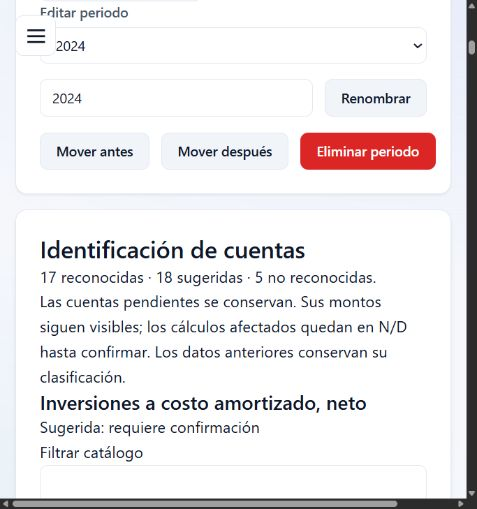

# 01 — Validación e informe de entrega

- **Estado**: Completado
- **Fecha**: 2026-10-17
- **Depende de**: [Investigación](investigacion.md)

## Resultado implementado

- Catálogo de 72 cuentas: 71 de los 20 JSON del PR #10, más `is.interest_income`. La instantánea fija el commit `a87ef0af0954e00d3f95ed1476ec3154bc06d768`; si se integran los JSON a main, las pruebas también contrastan sus copias vivas.
- Identificador y similitud puros; no hay asignaciones difusas automáticas. El corpus de la especificación tiene cero reconocimientos con id incorrecto.
- Registro único para importación y alta manual, metadatos validados, claves por nombre y compatibilidad de datos previos. Los 19 tipos anteriores no cambian.
- Filas sin identificar o sin grupo conservadas con sus montos y revisión confirmable; resumen de tres estados. La columna opcional `id` funciona en los formatos existentes.
- API de montos por id, políticas de ausencia y totales reportados; no se genera un total sumando componentes. Los datos suplementarios se conservan aparte.
- Lectura de metadatos y propagación conservadora de N/D en Análisis y Reportes, por aprobación adicional de Carlos. Sin migración al motor JSON ni modificación de fórmulas.

## Casos comprobados

1. Normalización: acentos, signos, palabras vacías, espacios y dígitos.
2. Similitud: omisión, letra repetida, transposición, plural y orden de palabras. Mayúsculas/acentos/espacios que dejan el mismo texto normalizado son exactos por R1.
3. Corpus negativo y ambigüedades: no se asigna id a Cuenta X, 123, texto vacío ni a candidatos sin confirmar. Ingresos por intereses ahora se reconoce por la excepción aprobada.
4. La plantilla tiene siete cuentas reconocidas. Los importes, límites, duplicados y claves peligrosas siguen validados.
5. Un registro manual y una importación producen la misma forma; JSON conserva estados de identificación y rechaza ids/tipos inválidos.
6. API: dato explícito, cero explícito, requerido ausente, total sin componentes, motivo por ambigüedad y desconocidas.
7. Regresión de MUNO MODA: se mantienen todos los valores de la tabla del encargo. No se añadió ni confirmó un dato de dividendos.
8. En navegador real, un borrador con `Efetivo = 50` muestra sugerencia, requiere confirmar y conserva el nombre. `Ingresos por intereses = 20` se reconoce sin pedir clasificación y suma 20 a utilidad.
9. El Excel público FDL 2025–2024 entra por el lector Excel del navegador: 40 cuentas conservadas, 17 reconocidas, 18 sugeridas y 5 no reconocidas; siete hojas de referencia generan avisos de lectura. No se guardó sobre los datos del usuario.

## Calidad

Ejecución final: `npm.cmd test` — **509 pruebas aprobadas en 38 archivos**, incluidas 73 pruebas nuevas de la colección. `npm.cmd run lint` — **cero errores y diez advertencias existentes** en archivos ajenos a esta tarea. `git diff --check` sin incidencias. No se instalaron dependencias. Rama creada desde `origin/main` actualizado (`2c11c4d`).

## Decisiones

D-029 a D-034 en `docs/decisiones.md`. Carlos aprobó las recomendaciones 1–4 y el ajuste mínimo de N/D. La calibración de similitud conserva los umbrales iniciales y documenta el apoyo por longitud combinada.

## Pendientes y límites

- El motor de razones JSON y la migración de módulos a ids quedan fuera de esta entrega. Su equipo debe decidir la fuente de verdad entre catálogo y copias JSON.
- Los dividendos 2024 permanecen sin confirmar por el usuario; no se modifica el dato ni las inferencias previas del EFE.
- Muchos alias españoles no tienen fuente externa literal. Se declaran expresamente como variantes del proyecto/JSON; no se atribuyen a una norma ni se inventan URLs.
- La disponibilidad se propaga conservadoramente por grupo; el futuro motor podrá distinguir dependencias por cuenta con más precisión. Un concepto sin tipo equivalente mantiene monto e id, y deja N/D en el motor anterior cuando no puede representarlo.
- El lector Excel de main sigue usando SheetJS 0.18.5 desde CDN. Su actualización y el PR de importación previo no se integran en esta tarea.
- La revisión humana del PR sigue pendiente; no se integra a main automáticamente.

## Checkpoint

- [x] Corpus e identidad del catálogo comprobados.
- [x] Regresión de las cifras y formulario manual comprobados.
- [x] Excel real y persistencia JSON comprobados.
- [x] Registrar resultado final de tests/lint; se prepara el PR en borrador con esta ficha.
